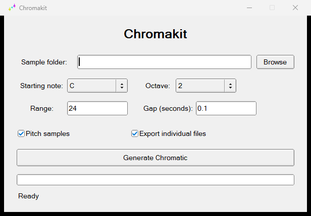
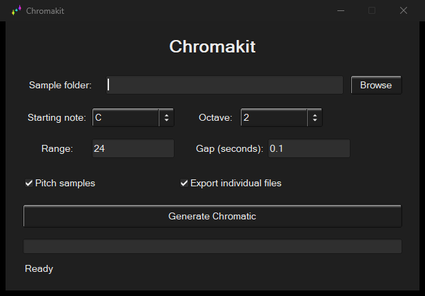

# Chromakit

Chromakit turns a folder of numbered WAV files into a chromatic set.

Chromakit was previously developed under the codename Auralis.

> [!WARNING]
> Chromakit is in alpha. It is still barebones and will get updates as the app grows.

Light mode:

Dark mode:

See the [release log](CHANGELOG.md) for changes in each version.

## Use it

1. Put your samples in one folder and name them `1.wav`, `2.wav`, `3.wav`, and so on.
2. Open Chromakit and choose that folder.
3. Pick the first note and octave. The octave picker covers C0 through C9.
4. Set the number of notes and the gap between them.
5. Leave **Pitch samples** checked to tune every sample to its note.
6. Click **Generate Chromatic**.

The samples are used in order and then repeated. For example, with five samples, notes 1 through 5 use samples 1 through 5, and note 6 uses sample 1 again.

The range is a note count, not an ending octave. Starting at C2 with a range of 90 produces notes C2 through F9.

## A couple of limits

All numbered WAV files must use the same sample rate and channel count. The names must start at `1.wav` without gaps.

Very large ranges can reach frequencies that are too high for the source sample or the output sample rate. If Chromakit rejects a range, use fewer notes or start at a lower octave.

Chromakit uses the same native folder picker as the operating system, so Browse follows the normal Windows, macOS, or Linux dialog. On Windows, the app follows the system light or dark theme when it starts.
